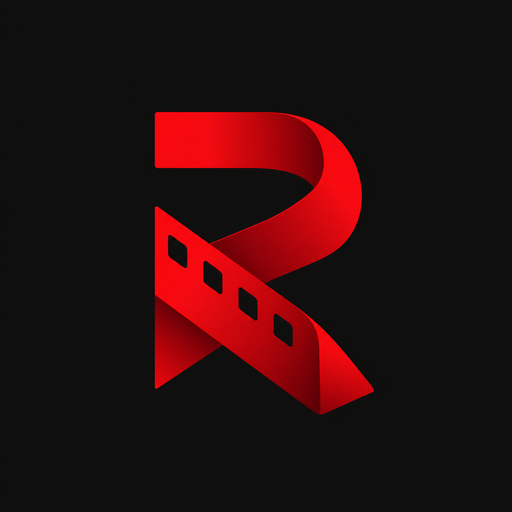
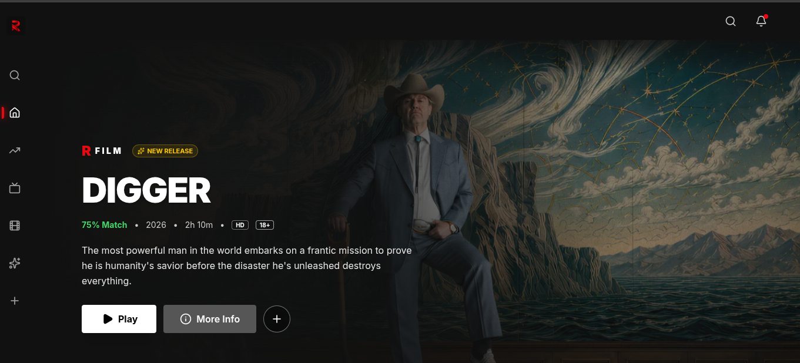
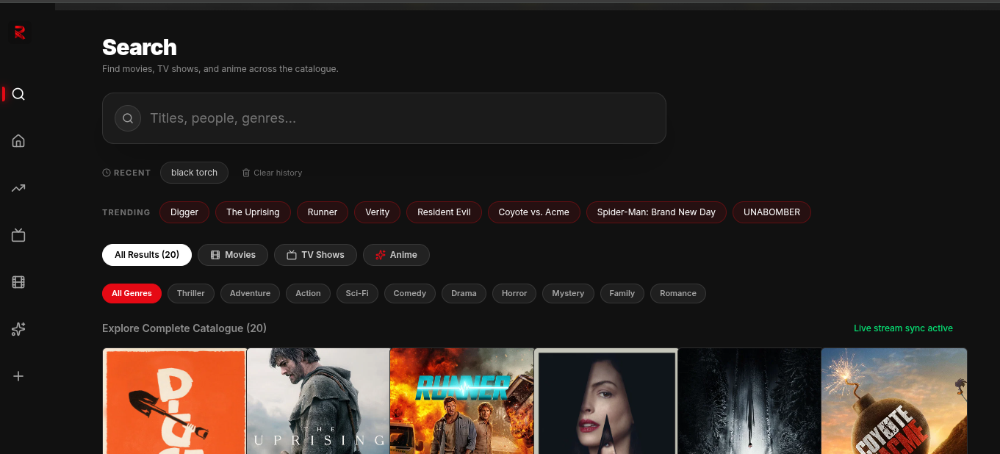
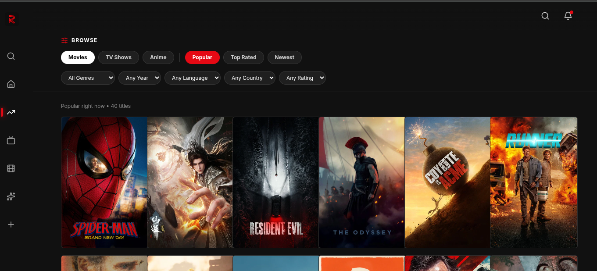
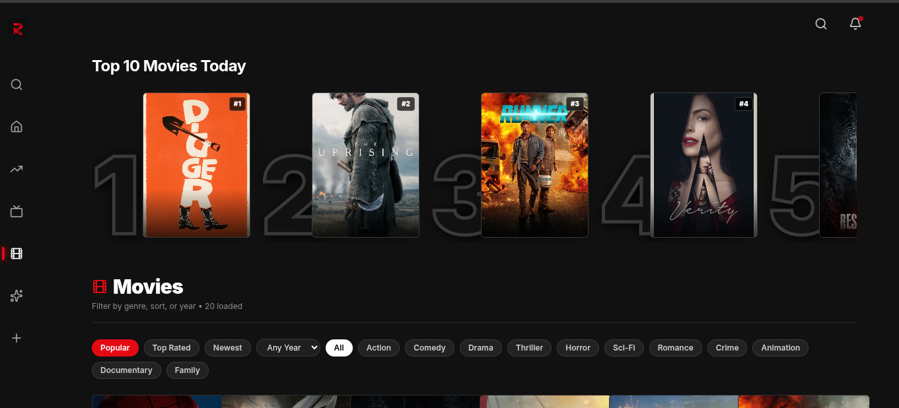
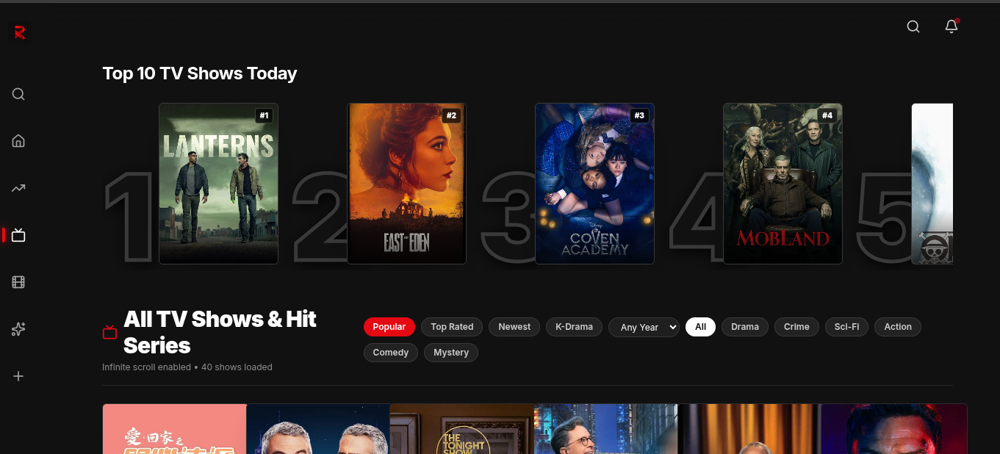
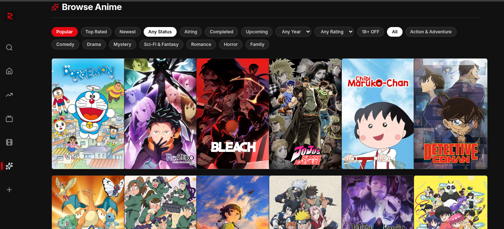
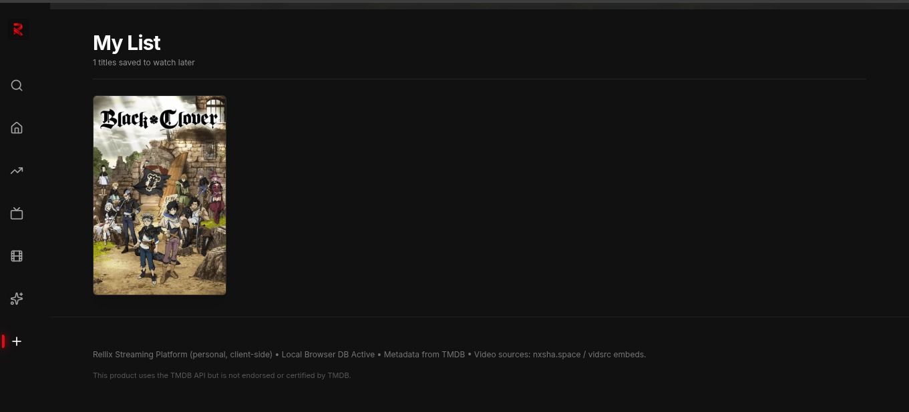

# Rellix

[](https://github.com/12errh/rellix-oss/actions/workflows/ci.yml)
[](LICENSE)
[](https://nextjs.org/)

<p align="center"></p>

> A Netflix-style streaming **browser** for movies, TV shows and anime — Next.js 15, React 19, Tailwind CSS 4, and no backend at all.

Rellix is a metadata browser and embed launcher. It pulls real catalogue data from
[TMDB](https://www.themoviedb.org), renders it as a streaming-style interface, and hands
playback to a third-party embed player. It does not host, proxy or transcode video.

Everything the app stores — profiles, PINs, My List, likes, watch progress, cached TMDB
responses — lives in the visitor's own browser (IndexedDB + localStorage). There is no
account system, no database, no API server and no build-time secret.

The production build is a **static export**: plain HTML, CSS and JavaScript in `out/`,
servable from GitHub Pages, Netlify, Cloudflare Pages, S3, nginx, or anything that can
serve files.

## Screenshots

| Home | Search | Browse |
| --- | --- | --- |
|  |  |  |

| Movies | TV Shows | Anime |
| --- | --- | --- |
|  |  |  |

| My List |
| --- |
|  |

## Features

- **Home** — hero carousel, Continue Watching, Top 10 Movies/TV, Trending Now,
  Because You Watched, and curated genre/region rails.
- **Search** — live TMDB multi-search, Top Match, genre/type filters, recent searches,
  trending chips, skeleton infinite scroll and fuzzy fallbacks on a miss.
- **Browse** — type, sort, genre, year, language, country and rating facets.
- **TV Shows & Movies tabs** — Top 10 rail plus type-appropriate filters and infinite scroll.
- **Anime tab** — spotlight, Currently Airing, New Episodes Today, Completed, status and
  rating filters, plus an 18+ toggle that excludes adult-anime keywords.
- **Details modal** — real per-season episode lists, trailers, cast, genres, and
  More Like This.
- **Video player** — labelled source switcher (Primary / Backup 1–2 / Custom URL),
  season/episode picker, best-effort watch-progress tracking, fullscreen, pop-out.
- **Profiles** — up to five local profiles, kids flag, optional 4- or 6-digit PIN.
  Changing or removing a PIN, and deleting a PIN-locked profile, require the current PIN.
- **Local-first** — My List, likes and continue-watching survive reloads in the same
  browser; nothing is uploaded anywhere.
- **PWA-ready** — installable, with a minimal offline shell.
- **Static export** — no Supabase, no auth, no API routes, no server process.

## The TMDB API key

Every rail, card, search result, rating badge and episode list is TMDB data. The official
API requires a key, and a static site has nowhere to hide one, so Rellix supports two
modes:

1. **Per visitor (default).** On first run a three-step setup asks for a free TMDB **v3 API
   key** and the first profile together. The key is validated against `api.themoviedb.org`
   and stored in `localStorage`. It is sent only to TMDB, and each visitor can use their
   own.
2. **Build-time default (operator convenience).** Set `NEXT_PUBLIC_TMDB_API_KEY` before
   `npm run build` and the key is compiled into the JavaScript bundle, so visitors are not
   prompted. **This value is public** — anyone who loads the site can read it. Use it for a
   private deployment, and give it its own TMDB account so it can be rotated.

Get a key at <https://www.themoviedb.org/settings/api>.

If TMDB is unreachable, the UI falls back to a small bundled catalogue so the page does not
go blank, but live search, browse and details need the key.

## Getting started

Requires Node.js 20.9 or newer.

```bash
git clone https://github.com/12errh/rellix-oss.git
cd rellix-oss
npm install
npm run dev
```

Open <http://localhost:3000>. Paste a TMDB key when prompted.

### Production build

```bash
npm run lint      # 0 errors, 8 expected no-img-element warnings
npm run typecheck
npm run build     # static export → out/
npm run preview   # serves out/ locally
```

`next build` with `output: 'export'` writes the whole site to `out/`. There is no server
entry point to run.

### Hosting

- Serve the **root** of the domain (or a subdomain). The export references `/_next/…`
  absolutely, so a sub-path deployment needs a rewrite or a separate host.
- `trailingSlash` is on: `/settings` becomes `/settings/`. Most static hosts handle this;
  if yours does not, enable directory-index fallback.
- `public/_headers` ships a Content-Security-Policy and cache rules for hosts that read it
  (Netlify, Cloudflare Pages). Copy the same headers into any other server.

nginx example:

```nginx
server {
  listen 443 ssl http2;
  server_name rellix.example.com;
  root /var/www/rellix/out;
  index index.html;

  add_header Content-Security-Policy "default-src 'self'; base-uri 'self'; object-src 'none'; form-action 'self'; frame-ancestors 'none'; img-src 'self' data: blob: https:; media-src 'self' blob: https:; style-src 'self' 'unsafe-inline'; font-src 'self' data:; frame-src https:; script-src 'self' 'unsafe-inline'; connect-src 'self' https://api.themoviedb.org https://image.tmdb.org; worker-src 'self'; manifest-src 'self'" always;
  add_header X-Content-Type-Options nosniff always;
  add_header X-Frame-Options DENY always;
  add_header Referrer-Policy strict-origin-when-cross-origin always;
  add_header Permissions-Policy "camera=(), microphone=(), geolocation=(), payment=(), usb=()" always;

  location /_next/static/ {
    add_header Cache-Control "public, max-age=31536000, immutable";
    try_files $uri =404;
  }

  location = /sw.js {
    add_header Cache-Control "no-cache";
  }

  location / {
    try_files $uri $uri/ $uri/index.html =404;
  }
}
```

`connect-src` must include `https://api.themoviedb.org` because the browser calls TMDB
directly. `frame-src` is `https:` rather than a fixed provider list because the Custom URL
source accepts any public http(s) embed.

## How the pieces fit

```
app/                    App Router pages: the single-page shell (/), /settings, manifest
components/             UI: hero, rails, cards, modals, tabs, player, profiles
hooks/                  use-paged-feed (infinite scroll)
lib/
  client-tmdb.ts        Browser TMDB client: mapping, search, discover, certifications
  client-media.ts       Answers the app's /api/media/* URLs with local Response objects
  kid-safe.ts           Session kid-mode flag + catalogue filter applied by client-media
  tmdb-key.ts           localStorage key storage + validation
  tmdb-cache.ts         IndexedDB TTL cache for TMDB responses
  db.ts                 IndexedDB profiles/watchlist/likes/progress + PIN hashing
  embed-urls.ts         Stream source ids, labels, embed URL builder
  prefs.ts              Default source + custom embed URL
  profile-session.ts    in-memory + sessionStorage "who is browsing" marker
  home-rails.ts         Home rail registry
  movies-data.ts        Offline fallback catalogue
public/                 Icons, service worker, _headers
types/                  Shared TypeScript types
assets/                 Logo + screenshots
```

The UI was originally written against seven read-only `/api/media/*` routes. Rather than
rewrite every component, `lib/client-media.ts` answers those same URL shapes with real
`Response` objects backed by `lib/client-tmdb.ts`. Components call `mediaFetch(...)` instead
of `fetch(...)`; query building, `res.ok` checks, JSON parsing and abort handling are
unchanged, and nothing leaves the browser except TMDB requests.

## Data, profiles and PINs

- Profiles, My List, likes, watch progress and cached metadata are stored in this browser.
  Clearing site data removes them. Settings → Storage offers a JSON export.
- The profile cap is five. Deleting the last profile is refused, because an app with no
  profile has no way back in.
- **The PIN is a convenience lock, not a security boundary.** It is salted and hashed with
  PBKDF2 where WebCrypto is available, and the pad has an escalating local lockout after
  repeated wrong entries. But the hash and the data sit in the same browser, so anyone with
  devtools or filesystem access can bypass it. Do not describe it as protecting data.
- Changing or removing a PIN requires the current PIN. So does deleting a PIN-locked
  profile — Settings can be opened without unlocking a profile, and deletion is the most
  destructive action there.
- A PIN-locked profile asks for the PIN again after a reload. A profile without a PIN
  resumes directly.
- Saving a new TMDB key in Settings takes effect for new requests. The app shell is a
  separate route from Settings, so returning to it remounts the rails with the new key.

## Legal and attribution

- This product uses the TMDB API but is **not endorsed or certified by TMDB**.
- Rellix hosts no video. Playback happens in third-party iframes; availability, ads and
  content are outside this project's control. The built-in sources are third-party sites
  that may host unlicensed material — check the law where you live before deploying this
  publicly, and prefer the Custom URL source with a provider you are allowed to use.
- The iframe sandbox stops popups, top-level navigation and downloads. It does **not** stop
  in-frame overlay ads or nested ad iframes; some built-in providers serve those.
- See `LICENSE` for the terms of use.

## Acknowledgements

Built as a personal learning project around the Next.js App Router, the TMDB API, and
IndexedDB.
